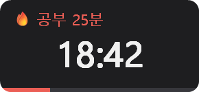
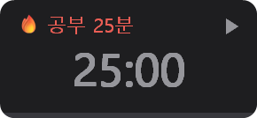
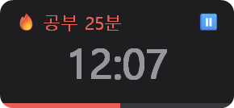
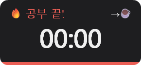
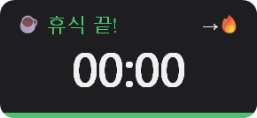
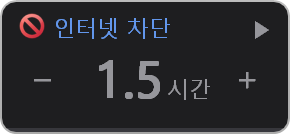
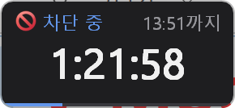

# 🍅 tiny-pomodoro

화면 구석에 조그맣게 떠 있는 Windows용 초경량 포모도로 타이머.

순수 Win32 C로 작성했고 C 런타임 없이 빌드합니다. 실행 중에도 **메모리 약 0.4MB, CPU는 거의 0**입니다.

<p align="center"></p>

## 화면

| 시작 전 | 공부 중 | 일시정지 |
|:-:|:-:|:-:|
|  |  |  |
| **공부 끝 (클릭하면 휴식)** | **휴식 중** | **휴식 끝 (클릭하면 공부)** |
|  |  |  |

평소엔 75% 투명하게 떠 있다가 마우스를 올리면 위처럼 또렷해집니다. 시간이 끝나면 알림음과 함께 깜빡입니다.

## 기능

- 화면 왼쪽 아래에 작게 표시, 항상 위
- 마우스를 올리지 않으면 75% 투명해지고, 올리면 또렷하게
- 드래그로 이동 (위치 기억)
- 🔥 공부 / ☕ 휴식, **25분/5분** 또는 **50분/10분** 모드
- **공부 4회마다 긴 휴식** (25분 모드 15분, 50분 모드 30분). 공부 중엔 `2/4`처럼 이번 세트의 몇 번째인지 표시. 오른쪽 클릭 메뉴에서 끌 수 있음
- 시간이 끝나도 자동으로 넘어가지 않음. 알림음과 함께 깜빡이고, **클릭해야** 다음 단계로 전환
- 🚫 **인터넷 차단 화면**: 지금부터 30분~12시간 동안 크롬·엣지에서 웹페이지를 막음. 열린 탭과 내 PC 파일(PDF)은 그대로, 다른 앱(AI 데스크톱 앱, Claude Code 등)은 그대로 인터넷 사용

## 인터넷 차단

오른쪽 클릭 → **화면 전환**으로 들어갑니다.

| 시작 전 | 차단 중 |
|:-:|:-:|
|  |  |

- `−` / `+` 클릭 또는 마우스 휠로 30분씩 시간을 고르고 (`1` → `1.5` → `2`, 숫자 위치는 고정), 가운데를 클릭하면 확인 창 → 관리자 권한(UAC) 확인 후 시작
- 크롬·엣지의 관리 정책(`URLBlocklist` = `*`)을 켜서 **새로 여는 웹페이지를 막음**. 브라우저는 닫지 않음
  - 이미 열려 있는 탭은 그대로 보임 (새로고침하거나 링크를 누르면 막힘)
  - 허용 목록(`URLAllowlist`): `file://*`(내 PC 파일), 내장 PDF 뷰어, `chrome://`·`edge://` 설정 화면. 브라우저를 **PDF 리더로 계속 쓸 수 있음**
  - **엣지**는 Microsoft 계정으로 로그인한 프로필엔 `URLBlocklist`를 적용하지 않음 ([MS 문서](https://learn.microsoft.com/en-us/deployedge/microsoft-edge-policies/urlblocklist)). 그래서 그런 프로필에도 적용되는 [`ProxySettings`](https://learn.microsoft.com/en-us/deployedge/microsoft-edge-policies/proxysettings)로 엣지의 프록시를 닫힌 포트(`127.0.0.1:9`)로 돌려 웹 요청을 모두 실패시킴. 엣지에선 "프록시 서버에 연결할 수 없음" 화면이 뜸 (로컬 PDF는 영향 없음)
  - 차단 중에는 브라우저에 "조직에서 관리" 표시가 뜸. 정책이 바로 안 먹으면 `chrome://policy` / `edge://policy` → 정책 새로고침
  - 앱은 차단 표시 키(`HKLM\SOFTWARE\TinyPomodoro`)가 실제로 있는지 확인해서, 다른 경로로 이미 풀렸으면 화면도 풀린 상태로 바꿈
  - 크롬·엣지에 이미 다른 URL 차단 정책이나 엣지 프록시 정책이 있으면 건드리지 않고 시작하지 않음
- 정책은 `HKLM` 레지스트리라서 시작할 때 UAC 확인이 한 번 필요
- 설정에 실패하면 원인을 `%APPDATA%\Pomodoro\block_error.log`에 남기고 오류 창에 보여 줌 (쓰던 정책은 모두 되돌림)
- 해제는 끝나는 시각에 **SYSTEM 예약 작업**(`PomodoroUnblock`)이 직접 함. 앱을 꺼도, 그 사이 재부팅해도 제때 풀림 (꺼져 있었다면 켜지자마자)
- 일찍 풀려면 차단 화면에서 오른쪽 클릭 → **지금 차단 해제** (UAC 확인)
- 차단 중에 포모도로가 끝나면 자동으로 타이머 화면으로 돌아옴

수동으로 풀어야 할 때는 관리자 PowerShell에서 (크롬·엣지의 URL 차단/허용 목록을 통째로 지우니, 직접 설정한 정책이 있다면 주의):

```powershell
foreach ($b in 'HKLM:\SOFTWARE\Policies\Google\Chrome', 'HKLM:\SOFTWARE\Policies\Microsoft\Edge') { Remove-Item "$b\URLBlocklist", "$b\URLAllowlist" -Recurse -EA 0 }
Remove-ItemProperty 'HKLM:\SOFTWARE\Policies\Microsoft\Edge' -Name ProxySettings -EA 0
Remove-Item HKLM:\SOFTWARE\TinyPomodoro -EA 0; Unregister-ScheduledTask -TaskName PomodoroUnblock -Confirm:$false -EA 0
```

## 사용법

| 동작 | 결과 |
|---|---|
| 왼쪽 클릭 | 시작 / 일시정지 (시간 종료 후엔 공부↔휴식 전환하고 바로 시작) |
| 드래그 | 위치 이동 |
| 오른쪽 클릭 | 화면 전환(타이머 ↔ 인터넷 차단), 모드 선택, 긴 휴식 켜기/끄기, 수동 전환, 리셋, 위치 초기화, 종료 |

끝까지 마친 공부만 횟수에 들어갑니다 (중간에 수동 전환하면 세지 않음). 횟수는 프로그램을 다시 켜면 처음부터 셉니다.

설정(모드, 긴 휴식 여부, 위치, 보던 화면, 차단 시간)은 `%APPDATA%\Pomodoro\settings.ini`에 저장됩니다.

## 다운로드

[Releases](../../releases)에서 `PomodoroNative.exe`를 받아 실행하면 됩니다. 설치 필요 없음.

## 왜 이렇게 가벼운가

처음엔 C#(WinForms)으로 만들었다가, 실험 삼아 같은 기능과 디자인을 순수 Win32 C로 다시 썼습니다.

| 타이머 실행 중, 30초 측정 | C# 버전 | C 버전 |
|---|---|---|
| CPU 시간 | 312ms | ≤ 15.6ms |
| 메모리 (Private WS) | 6.55MB | 0.43MB |
| 메모리 (전체 WS) | 33.4MB | 1.27MB |
| 스레드 / 핸들 | 7 / 276 | 1 / 84 |

- **폴링 없음**: 마우스 hover는 `TrackMouseEvent`로 이벤트를 받아 처리. 할 일이 없으면 타이머가 하나도 돌지 않음
- **필요할 때만 깨어남**: 표시되는 초가 바뀌는 순간에만 타이머를 걸어 다시 그림
- **컬러 이모지**: GDI는 컬러 이모지를 못 그려서, 미리 렌더링한 48px 이미지를 exe에 내장하고 시작할 때 한 번만 화면 크기로 축소한 뒤 픽셀 버퍼에 직접 알파 블렌딩
- **CRT 없음**: `-nostdlib`로 kernel32/user32/gdi32/dwmapi/shell32만 링크

## 빌드

[MinGW-w64](https://www.mingw-w64.org/) gcc가 PATH에 있어야 합니다.

```bat
native\build.bat
```

| 파일 | 설명 |
|---|---|
| `native/pomodoro.c` | 타이머 전체 소스 |
| `native/emoji_data.h` | 내장 이모지 데이터 (`gen_emoji.ps1`로 `emoji/*.png`에서 생성) |
| `native/make_block_emoji.ps1` | 🚫 `emoji/block.png` 생성 (다른 이모지와 어울리는 그라데이션) |
| `make_icon.ps1` | `icon/tomato-sauce.png` → `tomato-sauce.ico` 변환 |

## 라이선스

코드는 [MIT License](LICENSE)를 따릅니다.

## Credits

- 앱 아이콘: <a href="https://www.flaticon.com/free-icons/can" title="can icons">Can icons created by Magnific - Flaticon</a> ([Tomato sauce](https://www.flaticon.com/free-icon/tomato-sauce_904183), Flaticon License). 아이콘은 MIT 라이선스 대상이 아닙니다.
